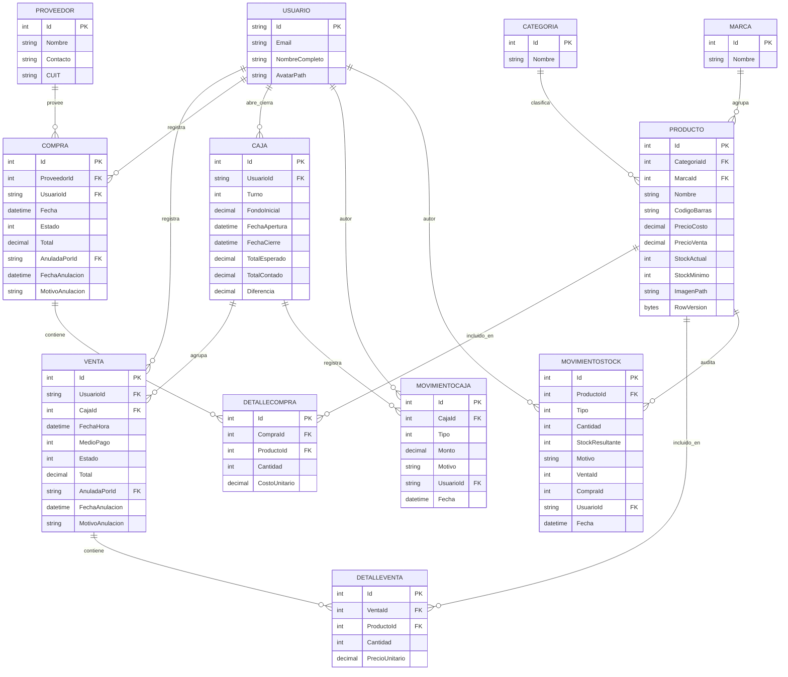

# KioscoPOS - Sistema POS para Kiosco 24hs
 
Proyecto final de **Laboratorio de Programación II**. Sistema web MVC (ASP.NET Core, .NET 10) con una Web API REST protegida con JWT, para gestionar las operaciones diarias de un kiosco que atiende las 24 horas en tres turnos.
 
## Descripción del proyecto
 
### Problema que resuelve
 
Un kiosco 24hs con varios cajeros por día suele llevar el control en planillas o cuadernos. Eso genera:
 
- Stock desactualizado y faltantes que se descubren tarde.
- Diferencias de caja entre turnos sin saber quién ni cuándo las generó.
- Falta de trazabilidad: qué se vendió, qué se compró, quién anuló una operación y por qué.
### Solución
 
KioscoPOS centraliza la operación en un solo sistema:
 
- **Ventas** con carrito, búsqueda de productos por nombre o código de barras, y medios de pago.
- **Compras a proveedores** con borrador, confirmación y anulación (solo Administrador).
- **Control de stock** con historial auditable de cada movimiento y ajustes manuales.
- **Caja por turno**: apertura con fondo inicial, ingresos y retiros, cierre con arqueo y diferencia.
- **Dashboard** con indicadores del negocio.
- **Seguridad** con login, roles y perfil con avatar.
- **API REST con JWT** para consultar el catálogo desde aplicaciones externas.
### Tecnologías
 
| Capa | Tecnología |
|---|---|
| Backend | ASP.NET Core MVC y Web API (.NET 10) |
| Persistencia | Entity Framework Core + MySQL (Pomelo) |
| Autenticación web | ASP.NET Core Identity (cookies) |
| Autenticación API | JWT Bearer |
| Frontend | Razor, Bootstrap, jQuery, Vue.js |
 
> La estructura completa del repositorio está en [docs/estructura.md](docs/estructura.md).
 
---
 
## Credenciales de prueba
 
Se crean automáticamente al ejecutar el seeder (o al importar el dump).
 
| Rol | Usuario / Email | Contraseña |
|---|---|---|
| Administrador | `admin@kiosco.com` | `Admin#2026` |
| Empleado | `cajero@kiosco.com` | `Cajero#2026` |

---
 
## Instalación y ejecución local
 
### Requisitos
 
- [.NET SDK 10](https://dotnet.microsoft.com/download)
- MySQL 8 (o MariaDB compatible)
- Herramienta de EF Core: `dotnet tool install --global dotnet-ef`
### Pasos
 
1. **Clonar el repositorio**
```bash
   git clone https://github.com/emadupre/Laboratorio-II-KioscoElRepo.git
   cd Laboratorio-II-KioscoElRepo
```
 
2. **Configurar la cadena de conexión.** `appsettings.Development.json` está excluido del repositorio (ver `.gitignore`), así que hay que crearlo en `KioscoPOS.Web/` y en `KioscoPOS.Api/`:
```json
   {
     "ConnectionStrings": {
       "DefaultConnection": "Server=localhost;Port=3306;Database=kioscopos;User=root;Password=TU_PASSWORD;"
     }
   }
```
 
   > Verificá que el nombre de la clave (`DefaultConnection`) coincida con el que usan los `Program.cs`. En la API también debe estar la clave JWT (`<NOMBRE_SECCION_JWT>`) con el mismo valor de configuración que usa el login.
 
3. **Crear la base de datos.** Elegí una opción:
   **Opción A: migraciones + seeder** (datos mínimos: roles, usuarios demo, categorías y marcas)
```bash
   dotnet ef database update --project KioscoPOS.Web
```
 
   **Opción B: dump con datos de prueba**
 
```bash
   mysql -u root -p -e "CREATE DATABASE kioscopos CHARACTER SET utf8mb4;"
   mysql -u root -p kioscopos < database/kioscopos-dump.sql
```
 
4. **Ejecutar la aplicación web**
```bash
   dotnet run --project KioscoPOS.Web
```
 
   Abrir la URL que indique la consola (`<URL_WEB>`, ver `Properties/launchSettings.json`).
 
5. **Ejecutar la API** (en otra terminal)
```bash
   dotnet run --project KioscoPOS.Api
```
 
   URL de la API: `<URL_API>`.
 
---
 
## Web API REST con JWT
 
La aplicación web no consume la API, por lo que se incluye una colección de Postman lista para importar: [`postman/KioscoPOS-API.postman_collection.json`](postman/KioscoPOS-API.postman_collection.json). Instrucciones en [`postman/README.md`](postman/README.md).
 
| Método | Endpoint | Auth | Descripción |
|---|---|:---:|---|
| POST | `/api/auth/login` | ❌ | Devuelve el token JWT |
| GET | `/api/productos` | ✅ | Lista de productos |
| GET | `/api/productos/{id}` | ✅ | Detalle de un producto |
 
**Uso rápido:**
 
1. `POST /api/auth/login` con `{ "email": "...", "password": "..." }`.
2. Copiar el token de la respuesta.
3. En las demás requests enviar el header `Authorization: Bearer <token>`.
---
 
## Matriz de evidencias de requerimientos mínimos
 
| Requerimiento mínimo | Estado | Enlace al código / controladores | Evidencia (captura / GIF / video) |
|---|:---:|---|---|
| **1. Modelo de datos: 6+ tablas, relación 1:N y N:M** | ✅ Cumplido | [ApplicationDbContext.cs](https://github.com/emadupre/Laboratorio-II-KioscoElRepo/blob/main/KioscoPOS.Web/Data/ApplicationDbContext.cs) | [Diagrama E-R](https://github.com/emadupre/Laboratorio-II-KioscoElRepo/blob/main/docs/evidencias/diagrama-er.png) |
| **2. Login, roles y avatar** | ✅ Cumplido | [CuentaController.cs](https://github.com/emadupre/Laboratorio-II-KioscoElRepo/blob/main/KioscoPOS.Web/Controllers/CuentaController.cs) | [Captura de perfil con avatar](https://github.com/emadupre/Laboratorio-II-KioscoElRepo/blob/main/docs/evidencias/Avatar_foto_perfil.png) |
| **3. Manejo de archivos (imágenes de productos)** | ✅ Cumplido | [ProductosController.cs#L209-L229](https://github.com/emadupre/Laboratorio-II-KioscoElRepo/blob/main/KioscoPOS.Web/Controllers/ProductosController.cs#L209-L229) | [GIF de subida de imagen de producto](https://github.com/emadupre/Laboratorio-II-KioscoElRepo/blob/main/docs/evidencias/Manejo_archivo_producto.gif) |
| **4. ABM en Vue.js + AJAX** | ✅ Cumplido | [categorias-gestion.js](https://github.com/emadupre/Laboratorio-II-KioscoElRepo/blob/main/KioscoPOS.Web/wwwroot/js/categorias-gestion.js) | [GIF del ABM dinámico](https://github.com/emadupre/Laboratorio-II-KioscoElRepo/blob/main/docs/evidencias/ABM_Vue.gif) |
| **5. Paginado por servidor** | ✅ Cumplido | [ProductosController.cs](https://github.com/emadupre/Laboratorio-II-KioscoElRepo/blob/main/KioscoPOS.Web/Controllers/ProductosController.cs) | [Captura del inspector de red con `page=2`](https://github.com/emadupre/Laboratorio-II-KioscoElRepo/blob/main/docs/evidencias/Paginador_producto.png) |
| **6. Selección asíncrona (AJAX)** | ✅ Cumplido | [ventas-nueva.js](https://github.com/emadupre/Laboratorio-II-KioscoElRepo/blob/main/KioscoPOS.Web/wwwroot/js/ventas-nueva.js) | [Captura de búsqueda de entidades en desplegable](https://github.com/emadupre/Laboratorio-II-KioscoElRepo/blob/main/docs/evidencias/Venta_buscando_entidades_desplegable.png) |
| **7. Web API + JWT** | ✅ Cumplido | [AuthController.cs](https://github.com/emadupre/Laboratorio-II-KioscoElRepo/blob/main/KioscoPOS.Api/Controllers/AuthController.cs) | [Captura de Postman con Bearer Token](https://github.com/emadupre/Laboratorio-II-KioscoElRepo/blob/main/docs/evidencias/Captura_Postman_Bearer_Token.png) |
 
### Detalle de cada punto
 
**1. Modelo de datos.** 12 entidades: `Categoria`, `Marca`, `Producto`, `Proveedor`, `Compra`, `DetalleCompra`, `Venta`, `DetalleVenta`, `Caja`, `MovimientoCaja`, `MovimientoStock` y `ApplicationUser`.
- **1:N:** `Categoria → Producto`, `Marca → Producto`, `Proveedor → Compra`, `Caja → Venta`, `Caja → MovimientoCaja`.
- **N:M:** `Venta ↔ Producto` mediante `DetalleVenta` y `Compra ↔ Producto` mediante `DetalleCompra`. Ambas tablas intermedias tienen atributos propios (cantidad, precio o costo unitario).
- `Venta`, `Compra` y `Caja` dependen además de `ApplicationUser`.

**2. Seguridad.** ASP.NET Core Identity con cookies. Los roles se crean en `DbSeeder`. La anulación de compras está restringida al rol Administrador mediante `[Authorize(Roles = ...)]`. Un Empleado que accede por URL a una ruta de Admin es redirigido a `AccesoDenegado`. El avatar se sube desde `Cuenta/Perfil` y se guarda en `wwwroot/uploads/avatares/`.
 
**3. Archivos.** Las imágenes de productos se guardan en `wwwroot/uploads/productos/` con nombre GUID (no se usa el nombre original del archivo). Se valida `<EXTENSIONES_PERMITIDAS>` y un tamaño máximo de `<TAMAÑO_MAX>`.
 
**4. ABM con Vue.** Las vistas `Categorias/Gestion` y `Marcas/Gestion` resuelven alta, baja, modificación y listado vía `fetch` con JSON contra endpoints de los controladores, sin recargar la página.
 
**5. Paginado.** `PagedResult<T>` (en `Paginado.cs`) aplica `Skip/Take` en la consulta y devuelve solo la página solicitada junto con el total. El cliente envía `?page=N`. Se aplica en los listados de Productos, Ventas, Compras, Historial de Stock, Historial de Cajas y Movimientos de Caja. `<VERIFICAR: ajustar esta lista a lo que realmente está paginado>`
 
**6. Búsqueda asíncrona.** El carrito de ventas busca productos contra `BusquedaController` (autocompletar por nombre y búsqueda por código de barras) y trae solo los resultados coincidentes. `<COMPLETAR: cómo se elige el proveedor en Compras/Create>`. Categoría y Marca en el formulario de producto son selects de tablas maestras pequeñas, tal como exceptúa la consigna.
 
**7. Web API.** `POST /api/auth/login` valida credenciales con Identity y emite un JWT con claims de usuario y rol. Los endpoints de lectura están protegidos con `[Authorize]`. API y Web comparten modelos y `ApplicationDbContext` mediante `<ProjectReference>`.
 
---
 
## Diagrama Entidad-Relación
 
Versión en imagen: [docs/evidencias/diagrama-er.png](docs/evidencias/diagrama-er.png). Descripción detallada de entidades en [docs/diagrama-er.md](docs/diagrama-er.md).
 

 
---
 
## Reglas de negocio destacadas
 
- Una **venta** descuenta stock y registra un `MovimientoStock`. Al anularse, devuelve el stock.
- Una **compra** confirmada suma stock. La anulación (solo Admin) lo revierte y guarda quién la anuló, cuándo y el motivo.
- Solo se puede vender con una **caja abierta** del turno. El cierre calcula el total esperado, lo compara con el contado y registra la diferencia.
- `Producto` usa `RowVersion` para control de concurrencia optimista (dos cajeros vendiendo el mismo producto a la vez).
- Las operaciones críticas de los servicios (`VentaService`, `CompraService`, `CajaService`, `StockService`) se ejecutan dentro de transacciones. `<VERIFICAR>`
## Documentación adicional
 
- [Narrativa y reglas de negocio](docs/narrativa.md)
- [Estructura del proyecto](docs/estructura.md)
- [Diagrama E-R detallado](docs/diagrama-er.md)

## Autores
 
`Bossa, José - jose.bossa.3@gmail.com`
`Suarez, Fernando - jorgefernandosuarez@gmail.com`
`García, Jesús Emanuel - dupre.dev@gmail.com `
