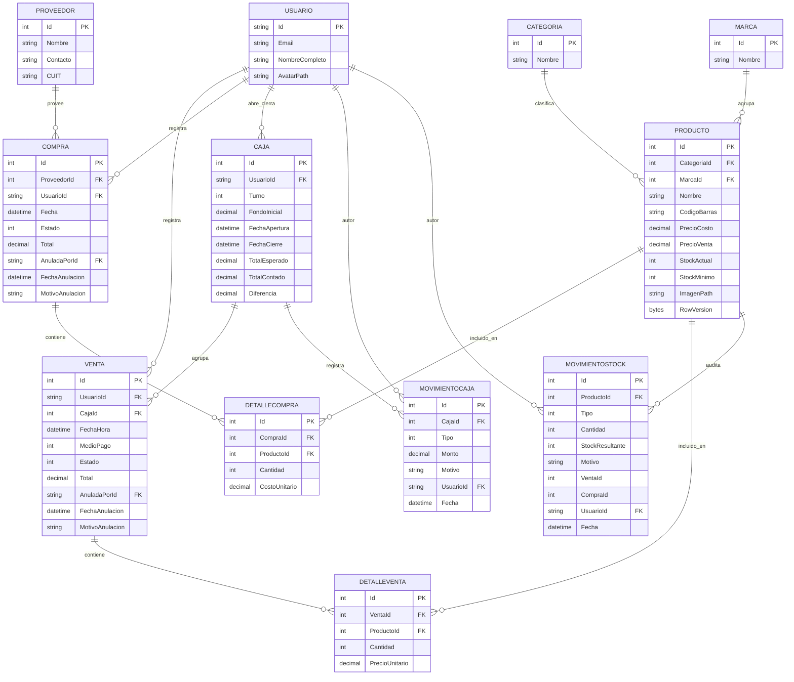
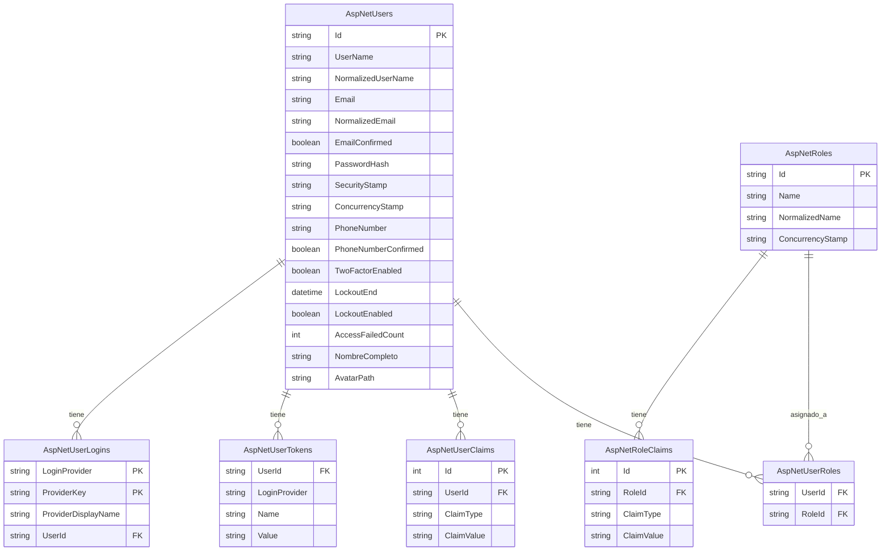

# Diagrama Entidad-Relación — KioscoPOS

Documento de diseño del modelo de datos del sistema **KioscoPOS: Sistema de Gestión Integral para Kioscos 24hs**.

---

## 1. Diagrama Entidad-Relación (nivel conceptual / lógico)

El siguiente diagrama representa el **modelo de dominio** del sistema. Las entidades reflejan los conceptos del negocio del kiosco, y las relaciones muestran las cardinalidades y dependencias entre ellas.

---

## 2. Descripción de entidades

| Entidad | Descripción |
|---|---|
| **CATEGORIA** | Catálogo de rubros del kiosco (Bebidas, Cigarrillos, Golosinas, Snacks, Almacén). Tabla maestra de baja frecuencia de cambio. |
| **MARCA** | Catálogo de marcas comerciales (Coca-Cola, Pepsi, Marlboro, Arcor, etc.). Permite una clasificación más granular que la categoría para búsquedas rápidas en el POS. |
| **PRODUCTO** | Ítem vendible. Almacena nombre, código de barras, precio de costo y venta, stock actual/mínimo, ruta de imagen y `RowVersion` para control de concurrencia optimista. |
| **PROVEEDOR** | Empresa que suministra mercadería. Contiene nombre, contacto y CUIT (validado con formato `XX-XXXXXXXX-X`). |
| **COMPRA** | Cabecera del documento de ingreso de mercadería. Registra proveedor, usuario, fecha, estado (`Borrador` / `Confirmada` / `Anulada`) y total. |
| **DETALLECOMPRA** | Línea de detalle de una compra. Vincula un producto con una cantidad y un costo unitario. |
| **VENTA** | Cabecera de la transacción de salida. Registra usuario (cajero), caja, fecha/hora, medio de pago, estado (`Confirmada` / `Anulada`), total y datos de anulación. |
| **DETALLEVENTA** | Línea de detalle de una venta. Vincula un producto con una cantidad y un precio unitario (tomado de la base, nunca del cliente). |
| **CAJA** | Representa un turno de un cajero. Almacena fondo inicial, fecha de apertura/cierre y los totales del arqueo (`TotalEsperado`, `TotalContado`, `Diferencia`). |
| **MOVIMIENTOCAJA** | Ingreso o retiro de efectivo extraordinario durante un turno (pago a proveedor, aporte de cambio, etc.). Justifica diferencias en el arqueo. |
| **MOVIMIENTOSTOCK** | Log de auditoría de todos los cambios de stock (venta, compra, ajuste manual, anulación). Permite trazabilidad completa. |
| **USUARIO** | Personal del sistema con rol `Administrador` o `Cajero`. Implementado como `ApplicationUser : IdentityUser` con campos adicionales `NombreCompleto` y `AvatarPath`. |

---

## 3. Descripción de relaciones

### 3.1 Relaciones 1:N (uno a muchos)

| Relación | Propósito |
|---|---|
| **CATEGORIA → PRODUCTO** | Un producto pertenece a una única categoría. Una categoría agrupa múltiples productos. Borrado `Restrict` para evitar productos huérfanos. |
| **MARCA → PRODUCTO** | Un producto pertenece a una única marca. Una marca agrupa múltiples productos. Borrado `Restrict`. |
| **PROVEEDOR → COMPRA** | Una compra está asociada a un único proveedor. Un proveedor puede tener múltiples compras. Borrado `Restrict`. |
| **COMPRA → DETALLECOMPRA** | Relación maestro-detalle. Una compra tiene N líneas. Borrado `Cascade` (si se borra el borrador, se borran sus líneas). |
| **VENTA → DETALLEVENTA** | Relación maestro-detalle. Una venta tiene N líneas. Borrado `Cascade`. |
| **CAJA → VENTA** | Todas las ventas de un turno quedan asociadas a la caja. Esencial para el cálculo del `TotalEsperado` en el arqueo. |
| **CAJA → MOVIMIENTOCAJA** | Agrupa los ingresos/retiros de efectivo de un turno. |
| **PRODUCTO → MOVIMIENTOSTOCK** | Historial completo de cambios de stock de cada producto. |

### 3.2 Relaciones N:M (muchos a muchos)

El modelo **no tiene relaciones N:M directas**. Se resuelven mediante **tablas intermedias** con semántica propia:

| Relación conceptual | Tabla intermedia | Semántica adicional |
|---|---|---|
| **PRODUCTO ↔ VENTA** | `DETALLEVENTA` | Cada línea agrega `Cantidad` y `PrecioUnitario`. |
| **PRODUCTO ↔ COMPRA** | `DETALLECOMPRA` | Cada línea agrega `Cantidad` y `CostoUnitario`. |

Esta es la técnica estándar de resolución de N:M, y en este caso las tablas intermedias **tienen atributos propios** (cantidad, precio), lo que las convierte en entidades de primera clase del modelo.

### 3.3 Relaciones de auditoría (FK a `USUARIO`)

| Relación | Propósito |
|---|---|
| **USUARIO → VENTA** (`UsuarioId`) | Registra qué cajero realizó cada venta. |
| **USUARIO → COMPRA** (`UsuarioId`) | Registra qué administrador cargó cada compra. |
| **USUARIO → CAJA** (`UsuarioId`) | Registra qué cajero abrió y cerró cada caja. |
| **USUARIO → MOVIMIENTOCAJA** (`UsuarioId`) | Registra quién hizo cada ingreso/retiro. |
| **USUARIO → MOVIMIENTOSTOCK** (`UsuarioId`) | Registra quién generó cada movimiento de stock. |
| **USUARIO → VENTA** (`AnuladaPorId`) | FK opcional. Registra quién anuló una venta (auditoría). |
| **USUARIO → COMPRA** (`AnuladaPorId`) | FK opcional. Registra quién anuló una compra (auditoría). |

Todas las relaciones con `USUARIO` usan `DeleteBehavior.Restrict` para evitar borrados accidentales que destruyan la trazabilidad.

---

## 4. Nota sobre las tablas de Identity

La entidad **USUARIO** del diagrama representa conceptualmente el esquema de autenticación de **ASP.NET Core Identity**. A nivel físico, el framework materializa la autenticación en las siguientes tablas autogeneradas:

| Tabla física | Propósito | ¿Se usa en el proyecto? |
|---|---|---|
| `AspNetUsers` | Usuarios del sistema (extiende `IdentityUser`) |  Sí — mapea a `ApplicationUser` |
| `AspNetRoles` | Catálogo de roles (`Administrador`, `Cajero`) |  Sí |
| `AspNetUserRoles` | Relación N:M entre usuarios y roles |  Sí |
| `AspNetUserClaims` | Claims adicionales por usuario |  No se usa |
| `AspNetUserTokens` | Tokens de recuperación / 2FA | No se usa |
| `AspNetUserLogins` | Logins externos (Google, Facebook, etc.) |  No se usa |
| `AspNetRoleClaims` | Claims por rol |  No se usa |

La entidad `ApplicationUser` (que hereda de `IdentityUser`) agrega los campos del dominio:

- `NombreCompleto` (string, 100) — nombre visible del usuario.
- `AvatarPath` (string, 255) — ruta relativa de la imagen de perfil.

**Justificación de la omisión en el DER:**

Por convención de ingeniería de software, las tablas de **infraestructura del framework** no se incluyen en el diagrama de dominio. El modelo conceptual abstrae la autenticación en la entidad `USUARIO` para mantener el diagrama legible y enfocado en las reglas de negocio. El esquema físico completo puede verificarse en la base de datos con `SHOW TABLES;` y se detalla en el apéndice de este documento.

---

## 5. Apéndice: Esquema físico de ASP.NET Core Identity

Diagrama complementario que muestra las tablas autogeneradas por el framework. Se incluye solo con fines académicos y de auditoría técnica.

**Roles definidos en el sistema:**

- `Administrador`: acceso total al sistema, incluyendo ver costos, gestionar catálogos, anular ventas y compras.
- `Cajero`: acceso restringido a apertura/cierre de caja, registro de ventas, consulta de productos y movimientos propios.

Los roles se siembran automáticamente al iniciar la aplicación mediante `DbSeeder.SeedAsync(...)`.

---

## 6. Reglas de negocio reflejadas en el modelo

| Regla | Dónde se implementa |
|---|---|
| El stock nunca puede quedar negativo | `CHECK CONSTRAINT` en `Producto.StockActual >= 0` + validación en `StockService` |
| No se puede vender sin caja abierta | `VentaService.ConfirmarAsync` valida `ICajaService.ObtenerCajaAbiertaAsync` |
| Un usuario no puede tener dos cajas abiertas | `CajaService.AbrirAsync` valida caja activa existente |
| Solo el dueño puede cerrar su caja | `CajaService.CerrarAsync` valida `UsuarioId` |
| Al anular venta/compra se revierte el stock | `VentaService.AnularAsync` / `CompraService.AnularAsync` |
| El costo del producto se actualiza al confirmar compra | `CompraService.ConfirmarAsync` actualiza `Producto.PrecioCosto` |
| No se puede anular una venta de una caja cerrada | `VentaService.AnularAsync` valida `Caja.FechaCierre == null` |
| Total esperado = Fondo + VentasEfectivo + Ingresos − Retiros | `CajaService.CalcularResumenAsync` |

---

## 7. Convenciones del modelo

- **Claves primarias:** `int` autoincremental en todas las entidades del dominio; `string` (GUID) en `USUARIO` por herencia de `IdentityUser`.
- **Claves foráneas:** `int` o `string` (según corresponda), con índice automático por parte de EF Core.
- **Borrados:** `Restrict` por defecto en relaciones críticas; `Cascade` en relaciones maestro-detalle puras (`DetalleVenta`, `DetalleCompra`, `MovimientoCaja`).
- **Concurrencia:** `Producto.RowVersion` como `[Timestamp]` para control optimista en operaciones de stock.
- **Auditoría:** toda operación crítica tiene `UsuarioId` + `Fecha` para trazabilidad.
- **Decimales:** todos los montos usan `decimal(18,2)` (precisión financiera).